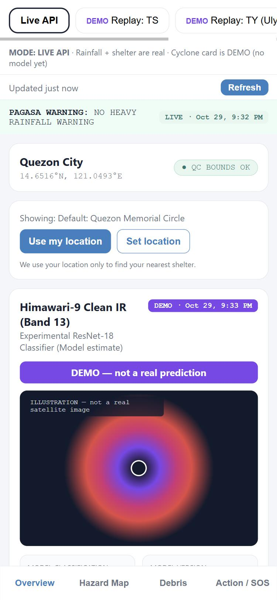
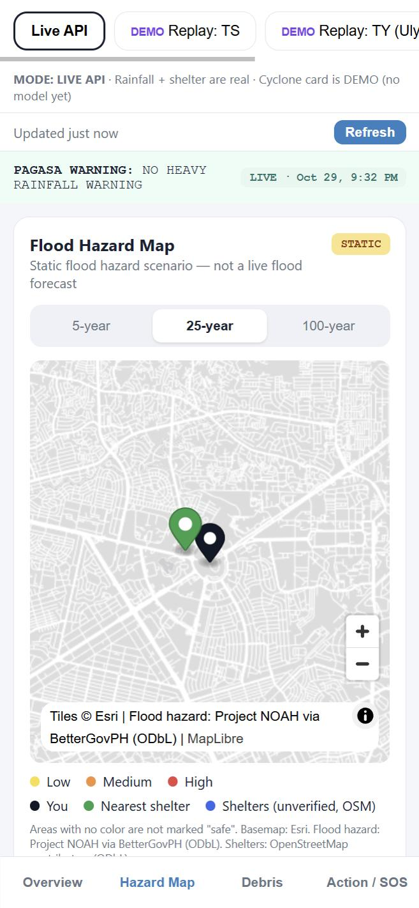
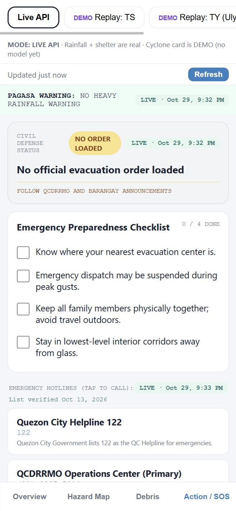

# Project AGAP

A web app that shows, for your location in Quezon City: a cyclone category, the current
PAGASA rainfall warning, a flood hazard map, your nearest evacuation shelter, and emergency
hotlines you can tap to call.

CS 403 Intelligent Agents final project. **Prototype only — not an official warning service.**

| | | |
|---|---|---|
|  |  |  |
| Overview | Hazard Map | Action / SOS |

## What is real and what is not

Every card in the app shows its own status badge and a timestamp, so you can always tell.

| Card | Today | Source |
|---|---|---|
| Rainfall warning | **Real**, scraped live | PAGASA NCR regional forecast page |
| Nearest shelter | **Real**, 239 facilities | OpenStreetMap, marked UNVERIFIED |
| Flood hazard map | **Real**, static scenarios | Project NOAH via BetterGovPH |
| Hotlines | **Real**, 6 numbers | Quezon City government, verified Oct 13 2026 |
| Cyclone category | **DEMO — fake data** | No model yet. Always badged DEMO |

The cyclone card is a placeholder until Team A delivers the ONNX model. It is never shown as
real: it carries a DEMO badge, a purple "not a real prediction" banner, and a warning line.

Two things the app deliberately will not do: it never reports "no warning" because a fetch
failed (it says `unknown` instead), and it never calls a point "safe" because no flood polygon
covers it.

## Before you start

| Tool | Version | Check with |
|---|---|---|
| Git | any recent | `git --version` |
| Python | **3.14** (not 3.15 — no onnxruntime build yet) | `py --version` |
| Node.js | 20 or newer | `node -v` |

If `py --version` shows something other than 3.14, install 3.14 from python.org and use
`py -3.14` in place of `py` below. `py --list` shows every version you have.

## Run it

You need **two terminals**, both open at the project folder. Start the backend first — the
frontend calls it, and shows an error screen if it is not running.

**Terminal 1 — backend** (Windows PowerShell, from `backend/`):

```
py -m venv .venv
.\.venv\Scripts\Activate.ps1
pip install -r requirements.txt
uvicorn app.main:app --reload --port 8000
```

You only do the first three lines once. After that, activating and running uvicorn is enough.
Check it at http://127.0.0.1:8000/docs — you can try every endpoint there.

**Terminal 2 — frontend** (from `frontend/`):

```
npm install
npm run dev
```

Open http://localhost:5173. The app is built for a phone screen, so it looks best narrow —
in your browser, press F12 and switch on the device toolbar.

Run the backend tests any time with `pytest` from `backend/` with the venv active.

## If something goes wrong

**`Activate.ps1 cannot be loaded because running scripts is disabled`** — Windows blocks
scripts by default. Run this once, then try again:

```
Set-ExecutionPolicy -Scope CurrentUser RemoteSigned
```

**The app loads but every card says it could not load** — the backend is not running, or it
is on the wrong port. It must be on 8000. Check http://127.0.0.1:8000/health/live shows
`{"status":"ok"}`.

**The map area is blank or grey** — the flood tiles and basemap are downloaded from the
internet, so the map needs a connection. The rest of the app works offline from cached data.

**Rainfall says UNAVAILABLE** — PAGASA's page is down or unreachable. That is the app
behaving correctly: it refuses to guess. It will recover on the next refresh.

## How the project is laid out

```
backend/app/     FastAPI: api/ routes, services/ logic, static/ data files
backend/tests/   pytest, no test ever touches the network
frontend/src/    React: components/ one file per card, api/client.js for every fetch
docs/            PROGRESS.md (status + decision log), contract/ (the API response shape)
```

Team rules for humans and AI tools: [AGENTS.md](AGENTS.md). Current status and who is doing
what: [docs/PROGRESS.md](docs/PROGRESS.md). The API response shape both sides follow:
[docs/contract/assess.sample.json](docs/contract/assess.sample.json). Defense walkthrough:
[docs/DEMO.md](docs/DEMO.md).

## Data sources

- Flood hazard: Project NOAH, via the BetterGovPH dataset (ODbL)
- Rainfall warnings: DOST-PAGASA
- Shelters: OpenStreetMap contributors (ODbL) — unverified, confirm with your barangay
- Basemap: Esri
- Hotlines: Quezon City government

## Disclaimer

This is a student prototype, not an official warning service. The cyclone category is a model
estimate and is **not** a PAGASA Tropical Cyclone Wind Signal. The flood map shows static
historical scenarios, not a live flood forecast. In an actual emergency, follow QCDRRMO and
your barangay.
